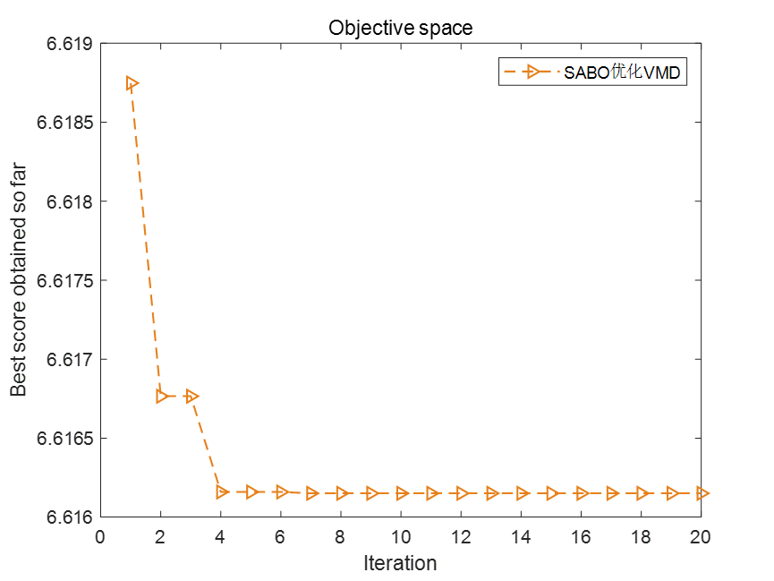
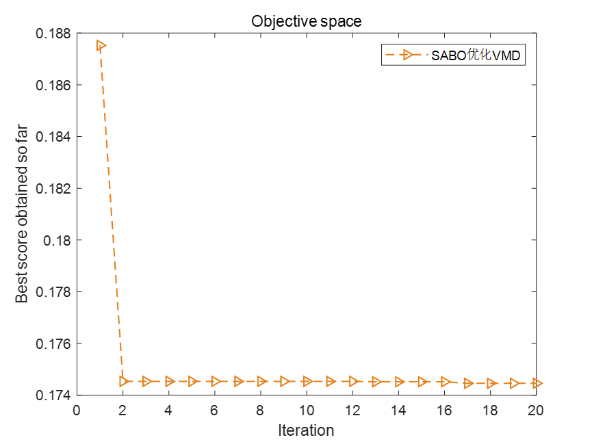
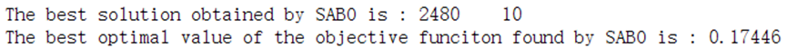
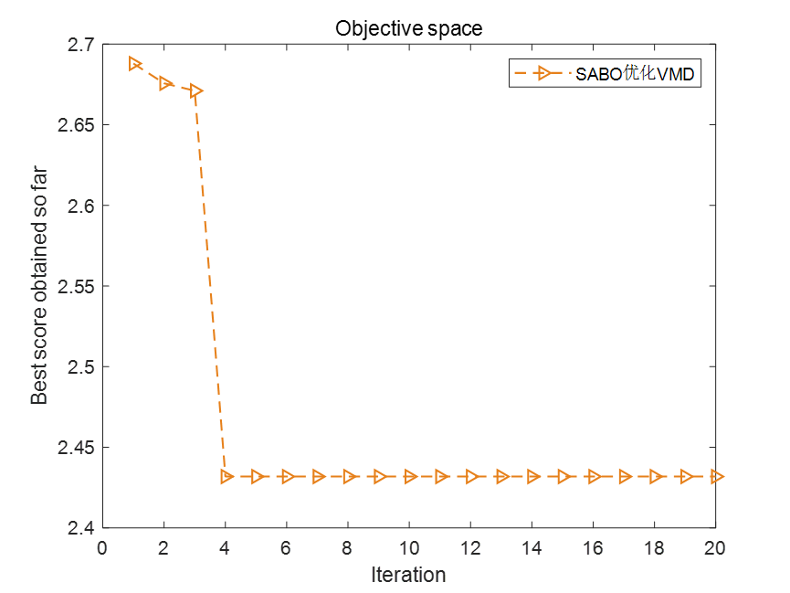
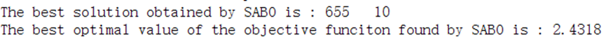

# Subtraction Optimizer SABO algorithm optimizes VMD parameters, minimum entropic envelope, sample entropy, information entropy, permutation entropy (fitness function can be selected by one-click modification). Included in MATLAB

Today, we bring you a session on the optimization of two parameters for the 2023 Intelligent Optimization Algorithm's Subtraction Optimizer SABO in VMD. For an in-depth explanation of the principle and MATLAB code of the Subtraction Optimizer SABO, please refer to this article. In 2023, let's delve into the subtraction average optimizer, directly copying the MATLAB code, and compare it with Grey Wolf and Particle Swarm Optimization algorithms.
Taking the Xiu Yu University dataset as an example, we will select the data from X105_BA_time.mat, containing 1000 data points. If you have no data, please refer to this article. Xiu Yu University Bearing Diagnosis Data Processing, Free MATLAB Code Available  
We will choose four fitness functions for optimization, thereby determining the optimal k and α parameters for VMD. The four fitness functions are: Minimal Entropy of Envelope, Minimal Entropy of Sample, Minimal Entropy of Arrangement, and Minimal Entropy of Information. The code allows for one-click switching between these options. As for which fitness function to choose, you can refer to this article. Why does VMD need parameter optimization? Which among Minimal Entropy of Envelope/Sample/Arrangement/Information should be chosen as the fitness function?
1. Minimal Entropy of Envelope as the fitness function
2. Minimal Entropy of Sample as the fitness function
3. Minimal Entropy of Arrangement as the fitness function
4. Minimal Entropy of Information as the fitness function
Code:
%% Optimize VMD using SABO algorithm with the objective functions of minimum entropies (minimum entropy, minimum sample entropy, minimum information entropy, minimum permutation entropy) (choose one of them), and find the optimal two parameters for VMD.\nclear\nclc\nclose all\nxz = 2;  %xz=1 or 2, choose 1 with minimum entropic package, choose 2 with minimum sample entropy, choose 3 with minimum information entropy, choose 4 with minimum permutation entropy\nif xz == 1  \n    fobj=@EnvelopeEntropyCost;          % Minimum Entropy\nelseif xz == 2\n    fobj=@SampleEntropyCost;            % Minimum sample entropy\nelseif xz == 3\n    fobj=@infoEntropyCost;              % Minimum Entropy\nelseif xz == 4\n    fobj=@PermutationEntropyCost;       % Minimum Arrangement Entropy\nend\n\n%% Select data\nload 105.mat\nda = X105_DE_time(6001:7000); % Here, select the DEtime data of 105. Note that you can replace this with your own data. The data should be in n rows * 1 column format, and the number of columns must be 1.\n\n%% Set parameters\nlb = [100 3];    % Penalty factor and the lower bound of K\nub = [2500 10];  % Penalty factor and the upper limit of K\ndim = 2;            % Optimize the number of variables\nMax_iter=20;       % Maximum number of iterations\nSearchAgents_no=25;       %Population size\n\n%% Call SABO function\n[fMin , bestX, Convergence_curve ] = SABO(SearchAgents_no,Max_iter,lb,ub,dim,fobj,da);\n\n%% Plot the fitness function curve and output the optimal parameters.\nfigure\nplot(Convergence_curve,'Color',[0.9 0.5 0.1],'Marker','>','LineStyle','--','linewidth',1);\ntitle('Objective space')\nxlabel('Iteration');\nylabel('Best score obtained so far');\nlegend('SABOOptimizationVMD')\ndisplay(['The best solution obtained by SABO is : ', num2str(round(bestX))]);  % Output the best location\ndisplay(['The best optimal value of the objective funciton found by SABO is : ', num2str(fMin)]);  % Output the best fitness value\nEveryone, pay attention to see.xzThis variable, when selected.1, Using the minimal entropic fitness function, select.2, Using the minimum sample entropy as the fitness function, select.3, Using minimal information entropy as the fitness function, select4, Use the minimum permutation entropy as the fitness function. This makes it very convenient for everyone to switch.。  

## Images

<!-- PAYMENT_BLOCK -->

## Get this dataset

- Payment link (Stripe): [Buy now](https://buy.stripe.com/3cs8yP7sY87d0vu9AB)
- Payment QR code: 

<!-- /PAYMENT_BLOCK -->
